# 💣 Kaboom Arena

A free retro arcade arena that runs in your browser: drop bombs, blast walls, grab power-ups
and outlast your rivals. Solo against bots, local on one screen, online with a room code or
Quick play, or a story mode with a very dysfunctional family of pyromaniacs.
Works on desktop, phone and tablet, installable as a PWA, and can keep the whole game offline.

**💣 Play it: https://kaboom.philament.club**  
**🖼️ Visual tour (screens, modes, story): https://kaboom.philament.club/tour/**

> A fan-made tribute to Konami's Bomberman. Not affiliated with or endorsed by Konami.
> All graphics and sounds are generated in code, no original assets are used.
>
> The "DLSS" / "RTX" graphics mode is a joke about GPU marketing. It uses text only, no logos, and is not affiliated with or endorsed by NVIDIA.
> Parody. Not affiliated with NVIDIA.
>
> "Bomber Shooter" (the first-person mode) is a nod to the boomer shooter genre. Original art, not affiliated with id Software.

<p align="center">
  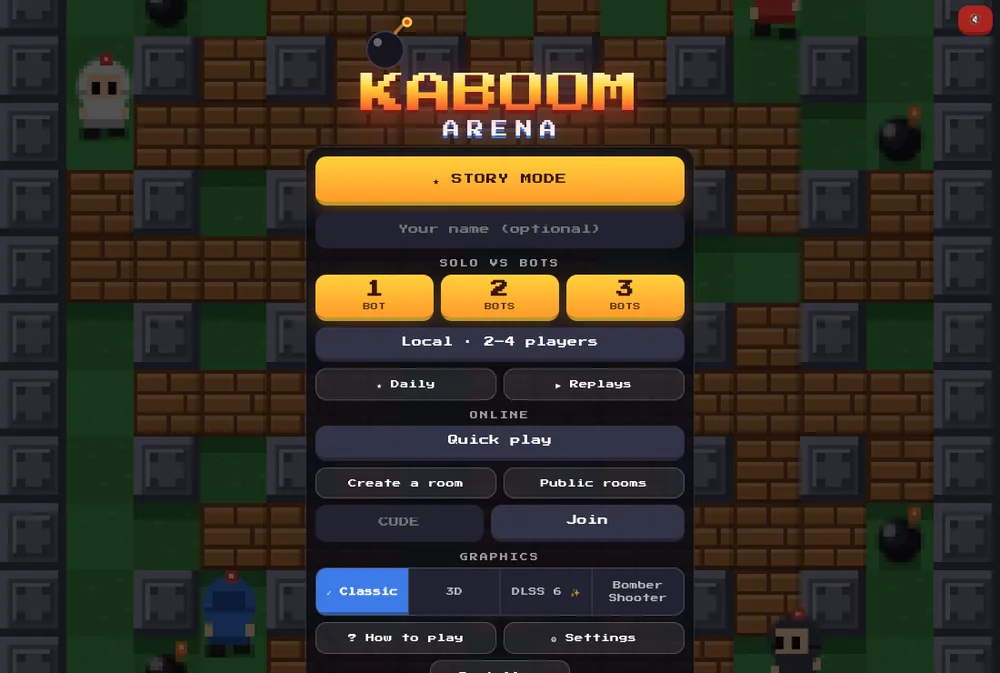
  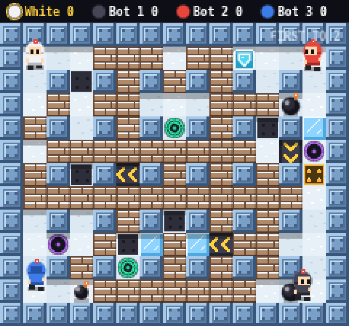
</p>
<p align="center">
  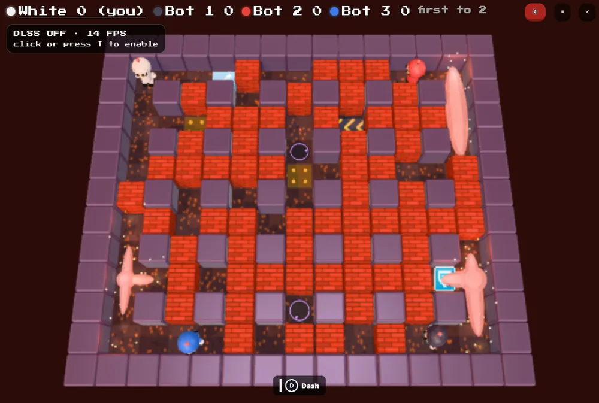
  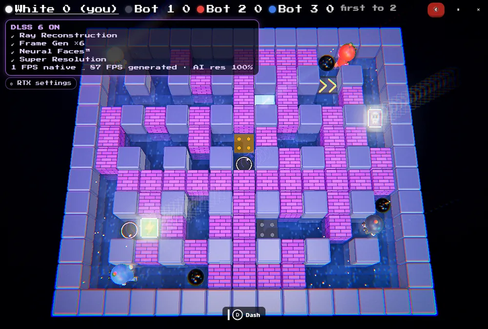
</p>

## Features

- **Ways to play**: solo vs 1-3 bots, local 2-4 players (keyboards and gamepads), online up to 4 players
  with a room code or **Quick play**, and a **story mode**. Best of 1-3 rounds, sudden death after 90 s.
- **Rules**: grid arena, chain-reacting bombs, destructible walls, 8 power-ups (bomb, range, speed, kick, remote, pass, shield, skull curse), 5 layouts, 5 themes, 2 vs 2 teams.
- **Floor tiles** (opt-in): ice you slide on, conveyor belts, teleporter pairs, timed spikes with a warning.
- **Chaos events** (opt-in): bomb rain, item rain, quake, player swap and frenzy, each announced 1.5 s ahead.
- **Game modes**: classic, **King of the Hill** (hold the moving 3x3 zone), **Hot Potato** (pass the fuse), **Survival** (waves of enemies).
- **Special bombs and abilities** (opt-in): cluster, mine and frost bombs, glove (throw) and punch (knock), plus a second button with one move per fighter (Dash, Blink, Aegis, Vanish, Crack, Overload, Switcheroo, Sweep, Rise).
- **Story mode**: nine fighters, a family tree of grudges, pre-fight banter, choices that change the next fight, three secret endings, a Story log, and **2-player co-op**.
- **Four looks**: Classic pixel art (2D canvas), 3D (Three.js), **DLSS 6** (a deliberately over-the-top parody: bloom, reflections, "Neural Faces", fake frame generation, a fake control panel) and **Bomber Shooter**, a first-person raycaster over the same match.
- **Procedural sound**: effects and music synthesised with WebAudio, no audio files. Styles Auto, Arcade, Epic, Chill, Synthwave or Silence (off by default), optional voice announcer, mute with `N`.
- **Replays**: every finished match is saved (last 10); watch it again in any look, seek and change speed, share a link (`#r=`) or a `.kaboom` file.
- **Daily challenge**: one seeded challenge per day (UTC) for everybody, best score and streak, shareable score card.
- **Online extras**: public rooms and Quick play, spectators, emotes (keys `1`-`8`), invite link and QR code, guest reconnect within 30 s, host-chosen rematch.
- **Game feel**: announcer banners, hit-stop and slow-mo on the deciding kill, round recap with awards, 3D camera shake.
- **Accessibility**: colour-blind palette (with player tags), reduce motion, phone vibration and gamepad rumble with intensity.
- **PWA**: installable, network-first service worker, and an **Offline** setting that caches the whole game (3D, portraits) for use without a connection.
- **Browser Back** closes the top layer instead of leaving the site: settings and lobbies go to the menu, a running offline game pauses first.
- **Smooth online play**: client-side prediction, snapshot interpolation, compact snapshots, RTT badge.

<p align="center">
  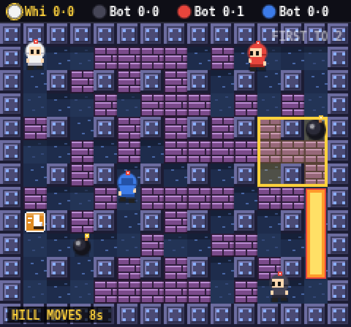
  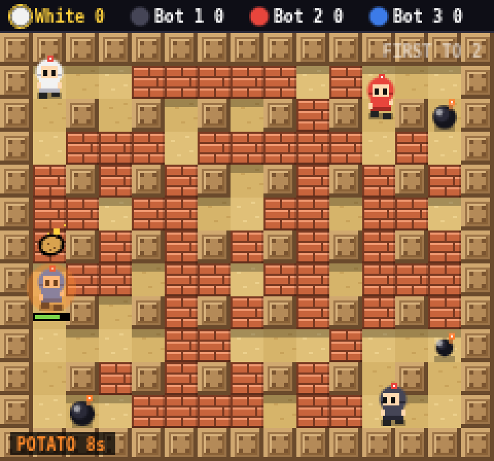
  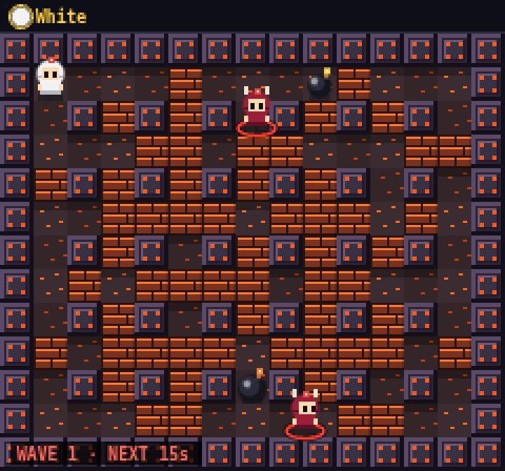
</p>
<p align="center">
  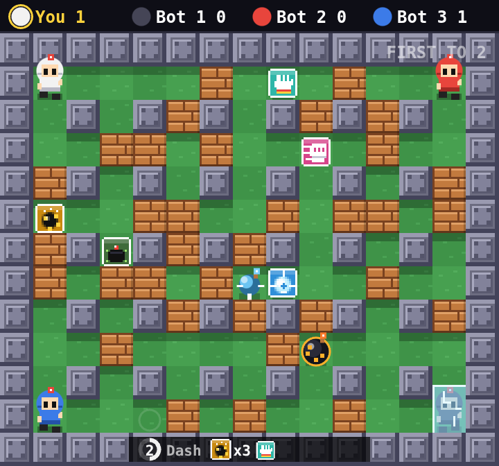
  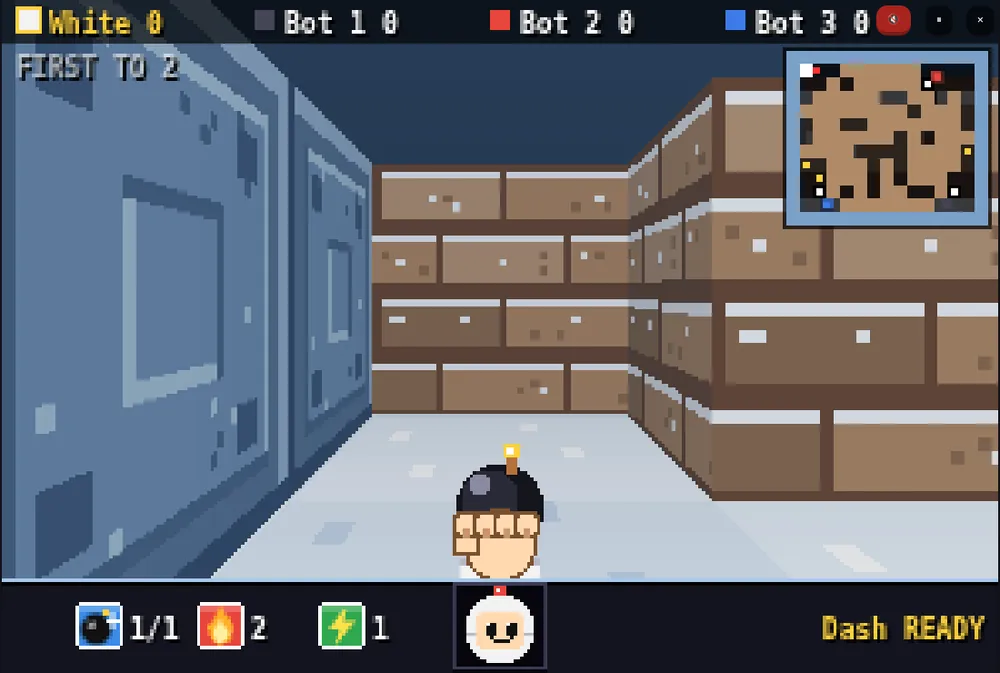
</p>
<p align="center">
  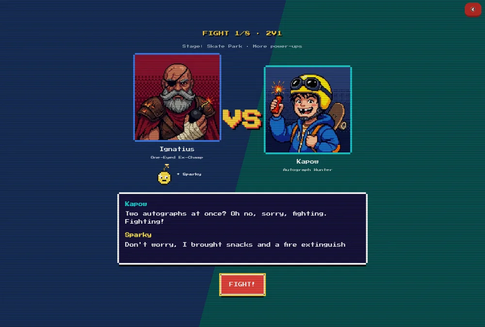
  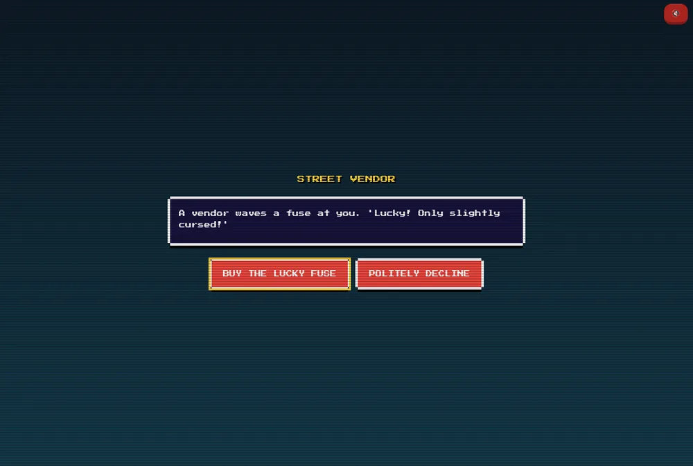
</p>
<p align="center">
  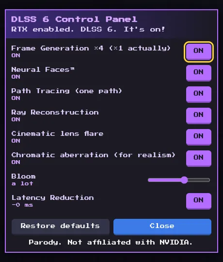
  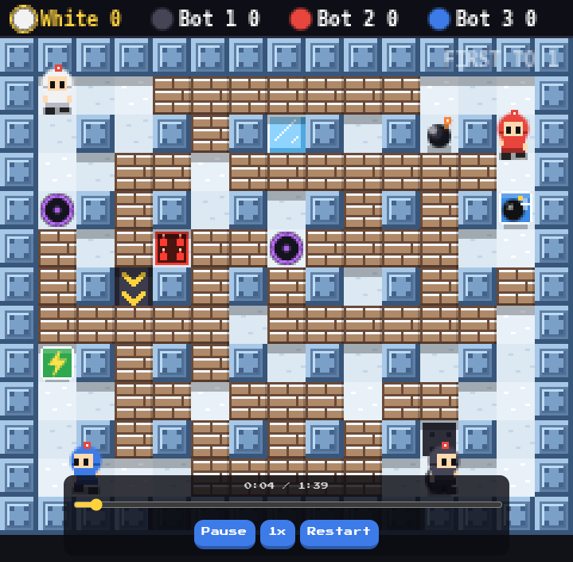
</p>
<p align="center">
  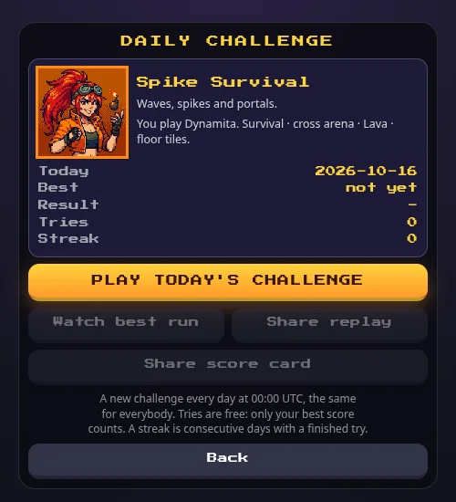
  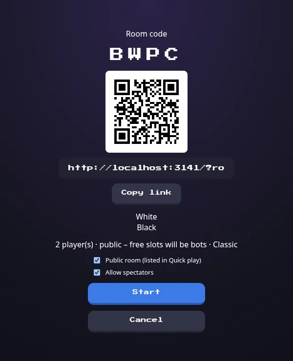
  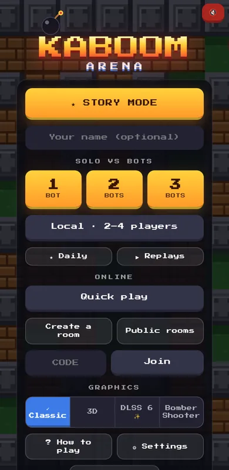
</p>

## Controls

| | Move | Bomb | Ability |
|---|---|---|---|
| Player 1 | `W A S D` / `Z Q S D` | `Space` | `E` / `Left Shift` |
| Player 2 | Arrow keys | `Enter` | `Right Shift` / `0` |
| Gamepad | D-pad / left stick | any button (A / B / Y) | `X` (only with abilities on) |
| Touch | Joystick | 💣 button | ⚡ button (only with abilities on) |

| Key | Action |
|---|---|
| `P` / `Esc` / Start / ⏸ | Pause (solo, local and story only) |
| `N` or the speaker button | Mute / unmute |
| `1`-`8` | Emotes (online; also a face button) |
| `T` / `G` | DLSS 6: toggle / open the fake control panel |
| `←` `→` `↑` `↓`, `,` `.`, `M` | Bomber Shooter: turn and walk, strafe, minimap (first player only) |
| Browser Back | Closes the top layer (see above) |

The bomb key also does the glove and punch moves when you have them: on a bomb it throws it, facing a bomb it knocks it away.
Append `?lag=120&jitter=40` to the URL to simulate a bad network.

## Settings

Everything persists in your browser. Most options apply to solo and local matches and to the online host.

| Group | Options |
|---|---|
| Match | Bots (easy / normal / hard), game mode, rounds to win, arena layout, theme, floor tiles, chaos events, special bombs, fighter abilities, power-ups, sudden death, 2 vs 2 teams, friendly fire |
| Game feel | Announcer banners, slow-mo and hit-stop, round recap, other players' emotes |
| Sound | Sound effects, music (Auto / Arcade / Epic / Chill / Synthwave / Silence, default Silence), volume, voice announcer (default off) |
| Accessibility and feedback | Colour-blind colours, reduce motion (system / on / off), phone vibration, gamepad rumble, intensity |
| Offline | Keep the whole game offline (downloads every file in the background) |

The story mode uses fixed rules (first to 2 rounds, sudden death, power-ups, friendly fire) and takes its arena from the opponent.
Graphics (Classic / 3D / DLSS 6 / Bomber Shooter) is chosen on the home screen.

## Run it locally

**You don't need Ruby or Rails to play.** Solo, local multiplayer, story, the bots, replays, the daily challenge and every graphics mode are
**plain static files**: no build step, no database, nothing to install beyond a static file server
pointed at `public/`. Pick whatever you already have:

```sh
python3 -m http.server 8000 -d public          # Python 3 (macOS, Linux, Windows)
npx serve public                               # Node.js
php -S localhost:8000 -t public                # PHP
ruby -run -e httpd public -p 8000              # Ruby, no gem needed
deno run -A jsr:@std/http/file-server public   # Deno
busybox httpd -f -p 8000 -h public             # BusyBox
```

Then open http://localhost:8000. (Use `localhost`, browsers only enable the service worker and
the Gamepad API on secure origins; any other host needs HTTPS.)

**Ruby/Rails is only needed for online play** (a small WebSocket relay, Ruby 3.4+, no database):

```sh
bundle install
bin/rails s -b 0.0.0.0        # http://localhost:3117, also serves the game
```

Without it, everything else works; only Quick play, "Create a room", "Public rooms" and "Join" won't connect.

## Tests

Game tests (Node 20+, no dependencies; simulation, bots, netcode, modes, story, replays, sound, DLSS 6 and more):

```sh
cd public/game && node --test *.test.mjs
```

Relay tests (Ruby):

```sh
ruby -Itest test/room_registry_test.rb
bundle exec ruby -Itest test/connection_limits_test.rb
```

## How it works

- `public/game/sim.js` is the whole game: a pure, deterministic 60 Hz simulation. Floor tiles, chaos, modes, special bombs and abilities are opt-in, and the classic path is pinned by golden-hash tests.
- **Solo/local/story**: the browser runs the simulation and the bots (`ai.js`).
- **Online**: the host's browser runs the simulation and broadcasts snapshots; guests send inputs
  and predict their own player (`netcode.js`). Rails/ActionCable (`app/channels/room_channel.rb`)
  is a dumb, hardened relay: server-assigned host, message allow-list per role, size and rate
  limits, per-IP connection caps, a public room list on demand. The host is trusted (it can cheat), by design.
- **Replays** are just recorded inputs plus a seed, so a link or a file replays the exact match, in any renderer, with no server.
- Renderers: `render.js` (2D), `render3d.js` (Three.js, vendored in `public/game/vendor`, loaded on demand), `renderfps.js` (first person).
- The home screen background is a live bot match (`home.js`), throttled to stay cheap.
- Contributor notes live in `CLAUDE.md`; the tone for new content is in `docs/ART_DIRECTION.md`.

## Deploy

A `Dockerfile` is included (single Puma process, ActionCable `async` adapter, no volume).
`deploy.sh` is the author's own script for a single server behind a shared reverse proxy; adapt it
or build the image yourself. Production expects `SECRET_KEY_BASE`, and allowed hosts/origins are
set in `config/environments/production.rb`. The reverse proxy must forward the real client IP
(the relay's per-IP limits rely on it).

## License

[WTFPL](LICENSE): do what the fuck you want to.
Vendored [Three.js](https://threejs.org) is MIT licensed (`public/game/vendor/THREE_LICENSE`).
