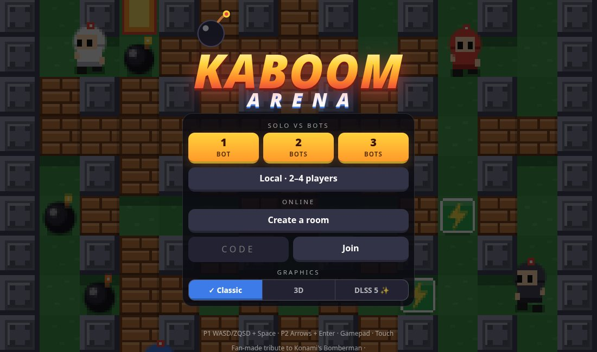
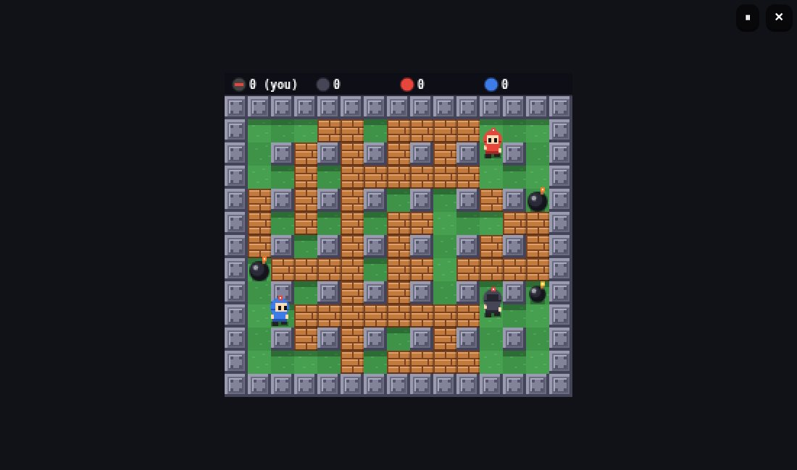
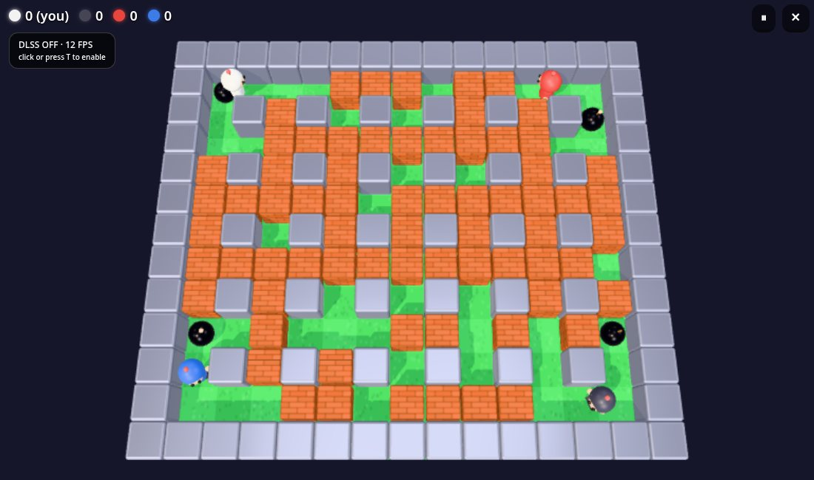
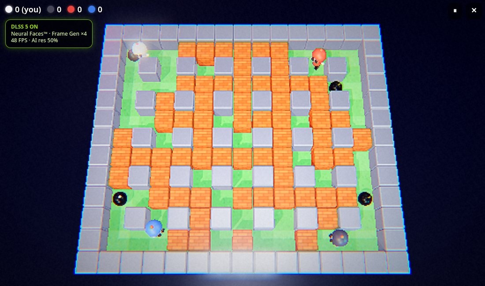
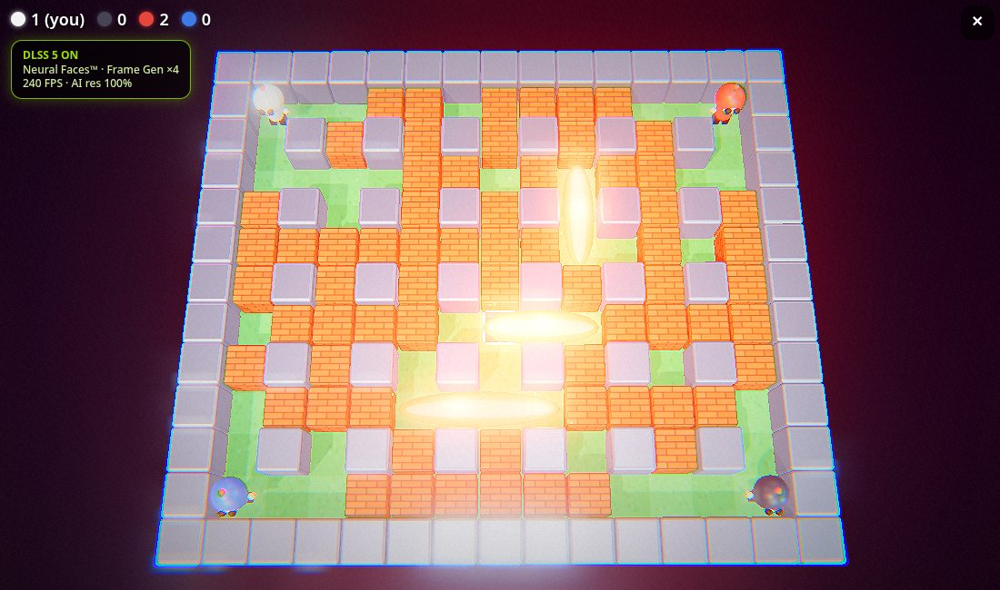

# 💣 Kaboom Arena

A free retro arcade arena that runs in your browser: drop bombs, blast walls, grab power-ups
and outlast your rivals. Solo against bots, local on one screen, or online with a room code.
Works on desktop, phone and tablet, installable as a PWA, solo mode works offline.

**💣 Play it: https://kaboom.philament.club**  
**🖼️ Visual tour (screens, power-ups, story mode): https://kaboom.philament.club/tour/**

> A fan-made tribute to Konami's Bomberman. Not affiliated with or endorsed by Konami.
> All graphics are drawn in code, no original assets are used.
>
> The "DLSS" / "RTX" graphics mode is a joke about GPU marketing. It uses text only, no logos, and is not affiliated with or endorsed by NVIDIA.

<p align="center">
  
  
</p>
<p align="center">
  
  
</p>
<p align="center">
  
</p>

## Features

- **Modes**: solo vs 1-3 bots, local 2-4 players (keyboards and gamepads), online up to 4 players
  with a 4-letter room code. Best of 3 rounds, sudden death after 90 s.
- **Rules**: grid arena, chain-reacting bombs, destructible walls, power-ups (extra bomb, range, speed).
- **Bots** that dodge blasts (with chain reactions), pick up bonuses and hunt walls and rivals.
- **Three looks**: Classic pixel art (2D canvas), 3D (Three.js), and **DLSS 5**, a deliberately
  over-the-top parody: bloom, chromatic aberration, "Neural Faces", fake frame generation counter,
  and a very real dynamic resolution.
- **Every device**: keyboard, gamepad (Gamepad API), touch (virtual joystick), pause with `P`/`Esc`/Start.
- **PWA**: installable, offline solo, network-first service worker.
- **Smooth online play**: client-side prediction, snapshot interpolation, compact snapshots, RTT badge.

## Controls

| | Move | Bomb |
|---|---|---|
| Player 1 | `W A S D` / `Z Q S D` | `Space` |
| Player 2 | Arrow keys | `Enter` |
| Gamepad | D-pad / left stick | A / B / X / Y |
| Touch | Joystick | 💣 button |

Pause: `P`, `Esc`, ⏸ button or gamepad Start (solo and local only).
Append `?lag=120&jitter=40` to the URL to simulate a bad network.

## Run it locally

**You don't need Ruby or Rails to play.** Solo, local multiplayer, the bots and the 3D modes are
**plain static files**: no build step, no database, nothing to install beyond a static file server
pointed at `public/`. Pick whatever you already have:

```sh
python3 -m http.server 8000 -d public          # Python 3 (macOS, Linux, Windows)
npx serve public                               # Node.js
php -S localhost:8000 -t public                # PHP
ruby -run -e httpd public -p 8000              # Ruby, no gem needed
deno run -A jsr:@std/http/file-server public   # Deno
busybox httpd -f -p 8000 -h public             # BusyBox
```

Then open http://localhost:8000. (Use `localhost`, browsers only enable the service worker and
the Gamepad API on secure origins; any other host needs HTTPS.)

**Ruby/Rails is only needed for the online mode** (a small WebSocket relay, Ruby 3.4+, no database):

```sh
bundle install
bin/rails s -b 0.0.0.0        # http://localhost:3117, also serves the game
```

Without it, everything else works; only the "Create a room" / "Join" buttons won't connect.

Tests (Node 20+, no dependencies):

```sh
cd public/game && node --test sim.test.mjs ai.test.mjs netcode.test.mjs
```

## How it works

- `public/game/sim.js` is the whole game: a pure, deterministic 60 Hz simulation.
- **Solo/local**: the browser runs the simulation and the bots (`ai.js`).
- **Online**: the host's browser runs the simulation and broadcasts snapshots; guests send inputs
  and predict their own player (`netcode.js`). Rails/ActionCable (`app/channels/room_channel.rb`)
  is a dumb, hardened relay: server-assigned host, message allow-list per role, size and rate
  limits, per-IP connection caps. The host is trusted (it can cheat), by design.
- Renderers: `render.js` (2D), `render3d.js` (Three.js, vendored in `public/game/vendor`, loaded on demand).
- The home screen background is a live bot match (`home.js`), throttled to stay cheap.

## Deploy

A `Dockerfile` is included (single Puma process, ActionCable `async` adapter, no volume).
`deploy.sh` is the author's own script for a single server behind a shared reverse proxy; adapt it
or build the image yourself. Production expects `SECRET_KEY_BASE`, and allowed hosts/origins are
set in `config/environments/production.rb`.

## License

[WTFPL](LICENSE): do what the fuck you want to.
Vendored [Three.js](https://threejs.org) is MIT licensed (`public/game/vendor/THREE_LICENSE`).
